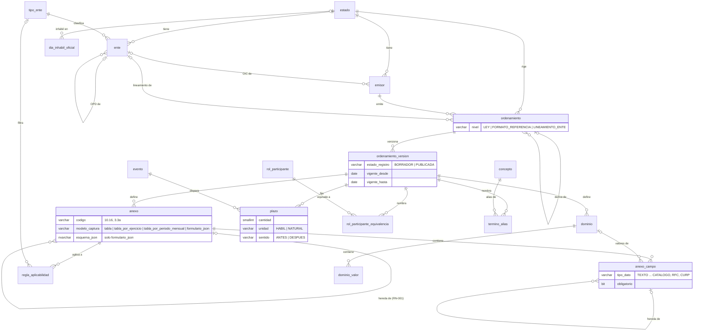

# ERD v0 — Catálogo normativo (BD central)

- **Estado:** v0 para revisión del PO/DBA
- **Migraciones:** `db/migrations/catalogo/V0001__rn003_plazos.sql`, `V0002__erd_v0_catalogo_normativo.sql`
- **Reglas:** RN-001 (jerarquía y herencia), RN-002 (versión publicada inmutable), RN-003 (plazos)

La versión del ordenamiento es el centro del modelo: todo lo que la norma define (anexos, campos, dominios, plazos, roles, alias) cuelga de una versión y se congela al publicarla.

## Decisiones reflejadas

| Decisión | Dónde |
| --- | --- |
| Tres niveles normativos y herencia ASE → OIC | `ordenamiento.nivel`, `anexo.anexo_referencia_id`, RN-001 |
| OPD con proceso y licencia propios | `ente` con `ente_padre_id` (no es unidad del ayuntamiento) |
| Catálogo nacional de roles con equivalencias | `rol_participante` + `rol_participante_equivalencia` |
| Alias legales por estado | `concepto` + `termino_alias` |
| Lista desplegable = campo de catálogo | `anexo_campo.tipo_dato = 'CATALOGO'` + `dominio` |
| Matrices por año o por mes = renglones generados | `anexo.modelo_captura` |
| Formularios en JSON con esquema | `anexo.esquema_json` (obligatorio si `formulario_json`) |
| Plazos configurables, hábiles por ente | `plazo` + `dia_inhabil_oficial` (RN-003) |

## Fuera de esta versión

- Proceso de E-R (BD del ente): proceso, comisión, participantes, unidades, anexos asignados, entregables, evidencia, acta, observaciones. Va en el ERD v0 del proceso.
- Licencias y facturación.
- Carga del catálogo semilla de Puebla a estas tablas (siguiente PR, ya con los campos revisados).
